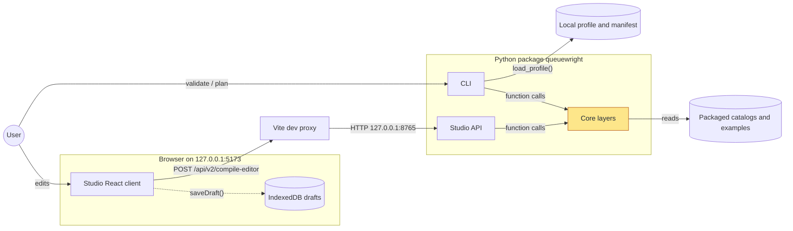
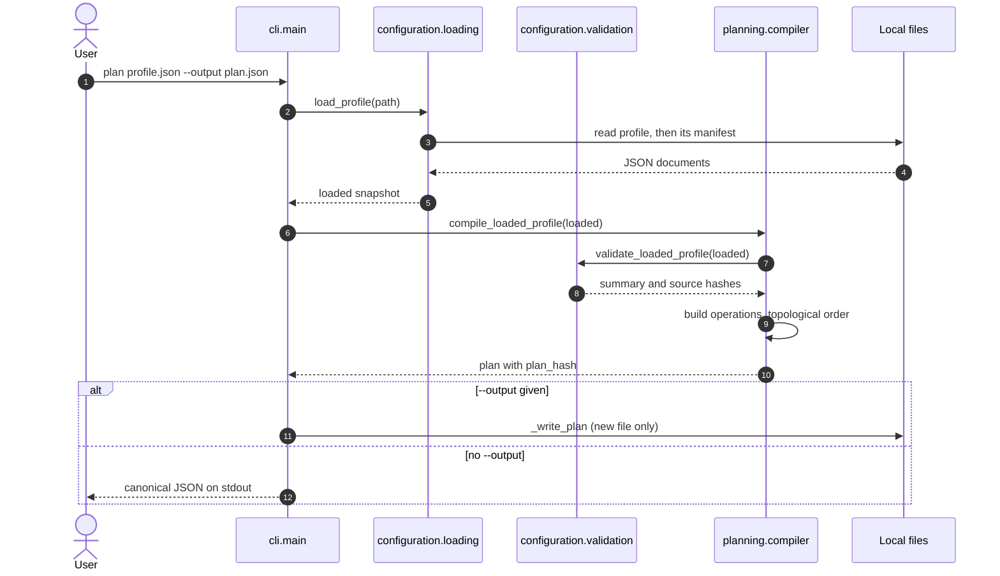
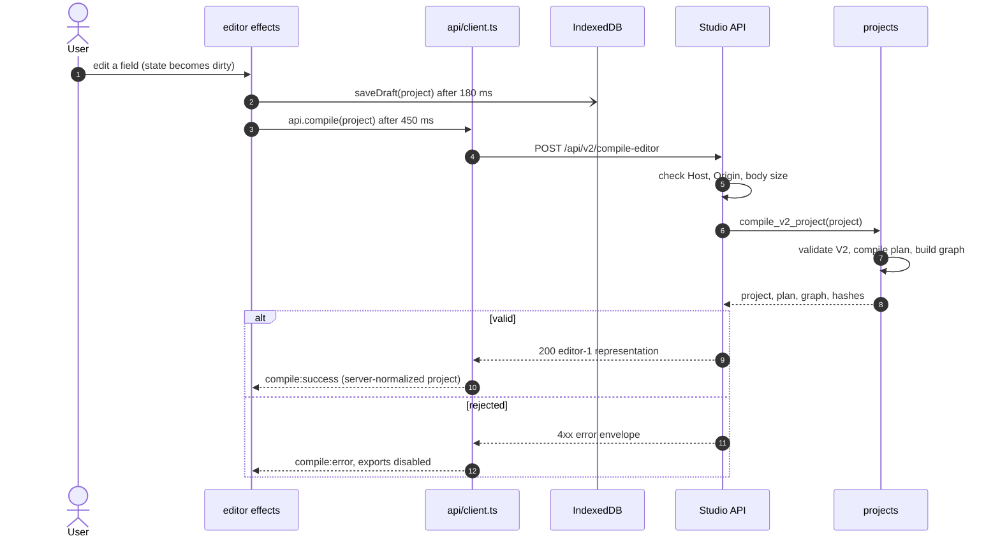
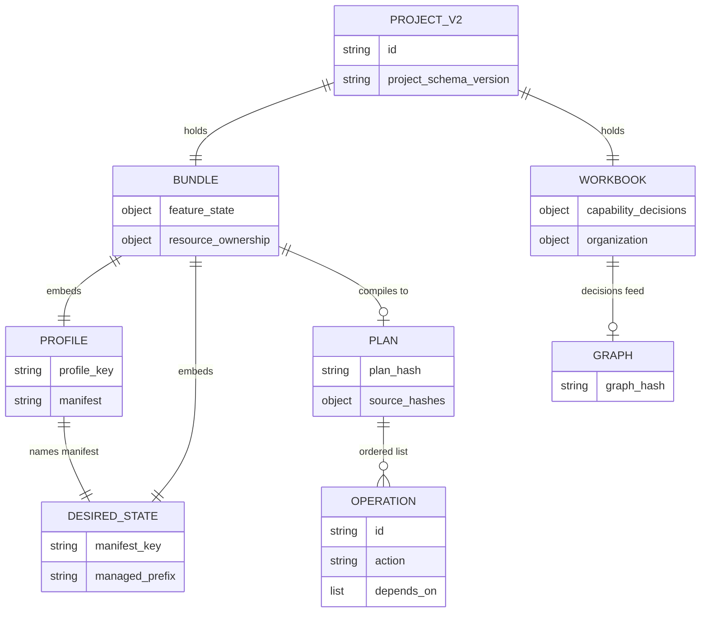
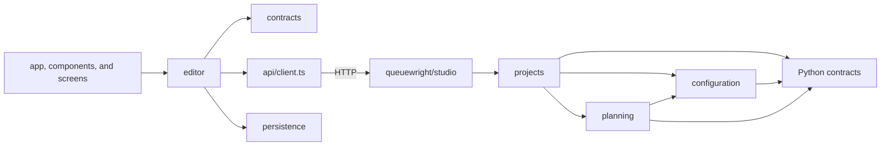
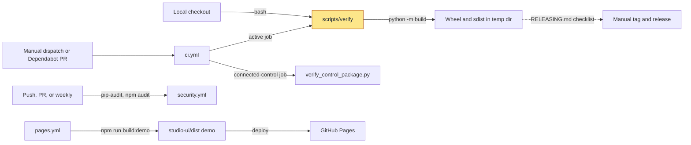

# Architecture

Queuewright is a modular monolith for offline Zammad configuration design. The
active Python distribution validates local JSON bundles, creates deterministic
review artifacts, and provides a bounded loopback API for Queuewright Studio.
It contains no tenant client, credential loader, or apply path.

Read this page top to bottom: what runs where, what happens when you run a
command or edit in Studio, what is stored, and where the code lives.

## System overview

What runs where, and what talks to what:



All real work happens in the **core layers** (`contracts`, `configuration`,
`planning`, `projects`). The CLI and the Studio API are two thin front doors to
the same functions: the CLI reads JSON files you name, and the API receives
JSON in request bodies. Neither writes anything back except the CLI's optional
`--output` plan file. Studio drafts live only in the browser's IndexedDB. The
static Pages demo is the same React client built without the API or
persistence (see [Build and release](#build-and-release)).
`experimental/connected_control/` has no edge to anything here, so it is not
drawn. It is a separate package that the active product never imports.

## How it runs

| Process | Started by | Listens on | State |
| --- | --- | --- | --- |
| CLI | `python -m queuewright validate\|plan\|self-test <profile>` | Nothing; exits after one command | None; reads the profile and its manifest |
| Studio API | `python -m queuewright studio` | `127.0.0.1:8765` only | In memory; catalogs loaded once at start |
| Studio client (dev) | `npm --prefix studio-ui run dev` | `127.0.0.1:5173`, proxies `/api/v1` and `/api/v2` to 8765 | React state plus IndexedDB |
| Static demo | GitHub Pages build | Served by Pages | None; bundled fictional data |

There is no database server, queue, worker, or outbound network call. See the
[Studio guide](STUDIO.md) for the endpoint list and browser-state rules.

Where in the code:
[queuewright/cli.py](../queuewright/cli.py) (`main`),
[queuewright/studio/server.py](../queuewright/studio/server.py) (`serve`, `HOST`, `PORT`),
[studio-ui/vite.config.ts](../studio-ui/vite.config.ts) (dev port and proxy).

## User journeys

### Running `queuewright plan`

What happens when you compile a profile on the command line:



Step 3 resolves the manifest relative to the profile and rejects escaping or
sensitive paths. Step 7 is the validation authority: cross-document references,
namespaces, and the safety contract. Step 9 turns each manifest resource into a
symbolic operation (`create_inactive` or `ensure_present`) with `depends_on`
edges, then orders them. Nothing is executed. Step 11 writes a temporary file
and hard-links it into place, so an existing file, the profile, or the manifest
is never overwritten. `validate` takes the same path but stops after step 8.

Where in the code:
[queuewright/cli.py](../queuewright/cli.py) (`main`, `_write_plan`),
[queuewright/configuration/loading.py](../queuewright/configuration/loading.py) (`load_profile`),
[queuewright/configuration/validation.py](../queuewright/configuration/validation.py) (`validate_loaded_profile`),
[queuewright/planning/compiler.py](../queuewright/planning/compiler.py) (`compile_loaded_profile`, `compile_validated_profile`).

### Editing a project in Studio

What happens between an edit in the browser and the updated plan on screen:



The draft is saved (step 2) before and independently of compilation, so an
invalid mid-edit draft is still kept. In step 5, `server.py` enforces loopback
`Host`/`Origin`, exact JSON framing, and the 2 MiB limit before
`StudioService.dispatch` picks a handler. In step 6, `routes.py` sends a V1
project to `compile_v1_snapshot` instead (migrating it to V2 on the way). Step 7
reuses the same `compile_validated_profile` as the CLI, then adds capability and
operation graph nodes. On success (step 9) the reducer replaces the browser
project with the server-normalized V2 project, so the server is the source of
truth for canonical form. A newer edit aborts an in-flight request, and
responses for an older revision are ignored.

Where in the code:
[studio-ui/src/editor/effects.ts](../studio-ui/src/editor/effects.ts) (`usePersistence`, `useAutomaticCompile`, `useCompileRunner`),
[studio-ui/src/api/client.ts](../studio-ui/src/api/client.ts) (`api.compile`, `expandEditorResponse`),
[studio-ui/src/persistence/drafts.ts](../studio-ui/src/persistence/drafts.ts) (`saveDraft`),
[queuewright/studio/server.py](../queuewright/studio/server.py) (`_StudioHandler._handle`),
[queuewright/studio/routes.py](../queuewright/studio/routes.py) (`StudioService`, `_compile_editor`),
[queuewright/studio/representation.py](../queuewright/studio/representation.py) (`editor_representation`),
[queuewright/projects/graph.py](../queuewright/projects/graph.py) (`compile_v2_project`, `_compile_validated`),
[studio-ui/src/editor/reducer.ts](../studio-ui/src/editor/reducer.ts) (`compile:success`).

## Data and state

How the documents relate. Authored documents are on the left, compiled
artifacts on the right:



A **profile** plus its **desired-state manifest** is the input the CLI reads
from disk. A **Blueprint V2 project** embeds that same pair in its `bundle`
and adds a `workbook` of authored decisions. Compiler-owned workbook sections
(such as `services` and `policies`) are derived projections, not a second
source of truth. V1 projects are a compatibility input that is migrated to V2.
**Plans** and **graphs** are never stored by Queuewright; they are recomputed
on each compile, and their hashes (canonical SHA-256) make results comparable.

| Store | Where | Holds | Owner |
| --- | --- | --- | --- |
| Profile and manifest files | Paths you pass to the CLI | Authored bundle | You |
| Plan output file | `--output` path, created once | Compiled plan | CLI `_write_plan` |
| IndexedDB `queuewright-studio`, store `projects` | Browser origin `127.0.0.1:5173` | V2 drafts keyed by project id | `persistence/drafts.ts` |
| IndexedDB store `meta` | Same | `active-project` id | Same |
| IndexedDB store `blueprints` | Same | Legacy drafts, copied into `projects` on upgrade and kept for recovery | Same |
| Packaged catalogs, schemas, examples | Inside the wheel | Feature and capability registries, JSON shapes, fictional examples | `contracts/`, `examples/` |

The active runtime reads no environment-based tenant configuration and has no
configuration-precedence stack. The only environment switch is build-time
`VITE_STATIC_DEMO=true`, used by the demo build. Server-side Studio state is in
memory. No database, migration service, backup process, hosted runtime,
metrics, authentication, or TLS termination is defined for the active product.

Where in the code:
[queuewright/contracts/schemas/](../queuewright/contracts/schemas/) (JSON shapes),
[queuewright/projects/v2.py](../queuewright/projects/v2.py) (V2 validation and migration),
[queuewright/examples/minimal/](../queuewright/examples/minimal/) (smallest complete profile, manifest, and project),
[studio-ui/src/persistence/drafts.ts](../studio-ui/src/persistence/drafts.ts) (IndexedDB stores).

## Code map

In the order a newcomer should read it:

| Path | Responsibility | Boundary |
| --- | --- | --- |
| [queuewright/cli.py](../queuewright/cli.py), [`__init__.py`](../queuewright/__init__.py), [`errors.py`](../queuewright/errors.py) | Command line, public Python API, and `ConfigurationError` | `queuewright.__all__` is the Python API |
| [queuewright/contracts/](../queuewright/contracts/) | `json` (canonical JSON), `paths` (packaged catalogs), `safety` (safe-JSON rules), `schemas/`, and `catalogs/` | Lowest active layer |
| [queuewright/configuration/](../queuewright/configuration/) | `loading`, `rules`, `validation`, `resources`, `automation`, `object_manager`, and `uat` for profile and desired-state validation | Reads explicit local bundles |
| [queuewright/planning/](../queuewright/planning/) | `compiler` (symbolic plans), `inventory`, and `limits` (compilation budget) | Produces inert review artifacts |
| [queuewright/projects/](../queuewright/projects/) | `bundle` (bundle fields, header checks, validation), `v1` (V1 model and artifacts), `v2` (Blueprint V2 and migration), `graph` (project compilation), `ownership`, `state`, `registry`, and `errors` | Pure domain logic; raises `ProjectError` and knows nothing of HTTP |
| [queuewright/studio/](../queuewright/studio/) | `routes` (`StudioService` route table, error envelopes, status mapping), `server` (loopback HTTP transport), `input`, and `representation` | Fixed loopback transport with in-memory state |
| [queuewright/examples/](../queuewright/examples/) | Packaged fictional profiles and projects, and `example_path` | Package data |
| [studio-ui/src/](../studio-ui/src/) | React client: `app`, `screens`, `components` (presentation); `editor` (reducer, commands, effects; `editor/model` is the model surface); `api` (fetch); `persistence` (IndexedDB); `contracts`, `data`, `styles` | Private Node package |
| [queuewright_studio/](../queuewright_studio/) | Shim: `python -m queuewright_studio` delegates to `queuewright studio` and re-exports `StudioService` and `create_server` | Removed at the first tagged release |
| [experimental/connected_control/](../experimental/connected_control/) | Connection, credential, evidence, recovery, ledger, and dispatcher primitives | Separate Python package and test suite |
| [scripts/](../scripts/) | `verify` (full gate), `check_architecture.py`, `verify_repo.py`, `verify_control_package.py` | Development only |

## Dependency direction

The active Python layers depend only on themselves or layers to their left:

```text
contracts <- configuration <- planning <- projects <- studio
```

`studio` may use `contracts` and `projects` directly. `projects` may use
`configuration`, `planning`, and `contracts`. A module must not import an
underscore-prefixed name from a different subpackage; private names are shared
only inside their own subpackage.

Error and status ownership follows the same direction. `projects` raises
`ProjectError` (a `ConfigurationError`) with a path and kind. Only
`queuewright/studio/routes.py` maps those errors to HTTP status codes and
error envelopes; `queuewright/studio/server.py` owns transport concerns such as
`Host` and `Origin` checks, body limits, and headers.

Packaged registries (feature catalog and capabilities) are loaded once by
`queuewright/projects/registry.py` and shared. A corrupt packaged registry
raises `ConfigurationError` ("feature registry ..."). There is no
custom feature-catalog injection.

The browser uses a similarly narrow set of seams:



`studio-ui/src/api/client.ts` is the only browser fetch surface.
`studio-ui/src/persistence/` is the only browser-storage surface.
[scripts/check_architecture.py](../scripts/check_architecture.py) enforces both
the Python direction and these frontend seams. It also rejects imports between
the active product and connected control.

## Safety and compatibility invariants

- Active code performs no outbound networking and accepts no tenant
  credentials.
- Studio binds only to loopback, validates `Host` and `Origin`, accepts exact
  JSON requests up to 2 MiB, and sends `Cache-Control: no-store`.
- Offline project completion may be `decision_required`, `ready`, or
  `blocked`; `applied` and `verified` require unavailable external evidence.
- Plans carry a fixed `safety` block (`execution: symbolic_plan_only`,
  `allow_delete: false`, `network_capability: false`).
- Bundled examples are fictional and use `example.invalid` identities.
- V1 import and migration remain compatibility contracts while V2 is
  canonical.
- `queuewright.__all__` is the Python API. The `queuewright_studio` shim
  exists only for the documented `python -m queuewright_studio` module entry
  and is removed at the first tagged release.
- Connected-control primitives remain isolated and are not evidence of a live
  Zammad integration.

There is no plugin system. Supported customization is through validated local
profiles, desired-state manifests, and safe Blueprint V2 extension data.

## Build and release

How code is checked and what gets published:



`scripts/verify` is the single gate, locally and in CI. It runs Ruff, the
architecture check, the Python self-test, repository and ignore policy, Vitest,
both Studio builds (`build` type-checks), and a package build whose wheel and
sdist are checked for packaged catalogs, schemas, and examples, then discarded.
`security.yml` runs dependency audits on push, pull request, and weekly.
`pages.yml` runs only on manual dispatch from `main`. It builds the client with
`VITE_STATIC_DEMO=true` and deploys `studio-ui/dist`, never the Python API.
Tags and package publication are manual; see [RELEASING.md](../RELEASING.md).

Where in the code:
[scripts/verify](../scripts/verify),
[.github/workflows/ci.yml](../.github/workflows/ci.yml),
[.github/workflows/security.yml](../.github/workflows/security.yml),
[.github/workflows/pages.yml](../.github/workflows/pages.yml),
[studio-ui/package.json](../studio-ui/package.json) (`build`, `build:demo`).

The governing architectural decision is recorded in
[ADR 0001](adr/0001-modular-monolith-and-isolated-control.md).
